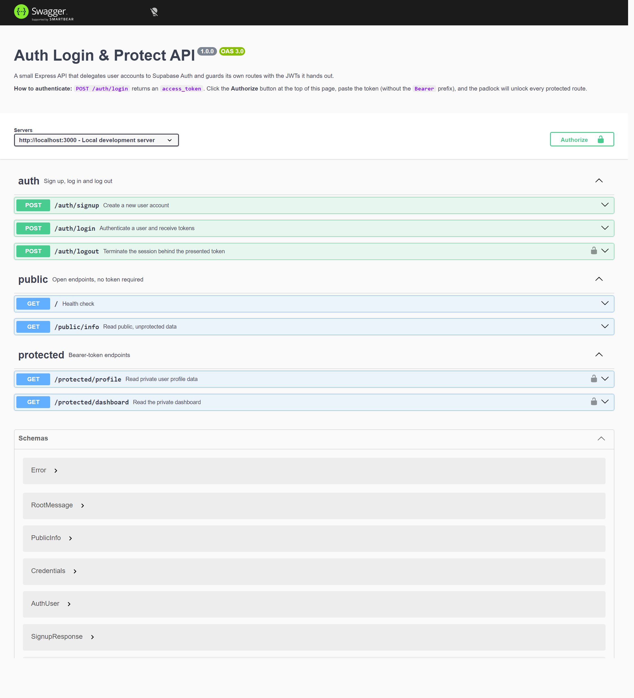

# Auth Login & Protect

A small Express API that delegates user accounts to [Supabase](https://supabase.com) Auth and then guards its own routes with the JWTs it hands out. Sign up, log in, log out — and prove that `/protected/*` really does reject anyone without a valid token.

Built as the **Auth Login & Protect** assignment (see [`project.md`](project.md) for the original brief).



## How it works

Authentication is a triangle between three parties:

1. **Client → Supabase** — credentials go straight to the Identity Provider, never through this server.
2. **Supabase → Client** — Supabase validates them and returns a signed **JWT** access token.
3. **Client → this server** — the token rides along in `Authorization: Bearer <token>`.
4. **This server → Supabase** — before any protected handler runs, `requireAuth` asks Supabase to verify the token (`supabase.auth.getUser(token)`). Only a verified user reaches the route.

The important bit is step 4: this server never trusts a token because the client says so. It checks the signature, the expiry and whether the session still exists, and rejects anything else with a `401`.

## Tech stack

| | |
|---|---|
| Runtime | Node.js 20.6+ (uses the built-in `--env-file` flag) — tested on v24 |
| Framework | Express 5 |
| Auth | Supabase Auth (`@supabase/supabase-js`) |
| Docs | `openapi.json` served with `swagger-ui-express` at `/docs` |
| Config | `.env` for secrets, git-ignored |

## Setup

### 1. Prerequisites

- Node.js 20.6 or newer
- A free [Supabase](https://supabase.com) project

### 2. Get your Supabase credentials

In the Supabase Dashboard open your project and go to **Project Settings → API**. You need two values:

| Value | Where | Used for |
|---|---|---|
| **Project URL** | Project Settings → API | `SUPABASE_URL` |
| **anon public** key | Project Settings → API → Project API keys | `SUPABASE_KEY` |

Use the **anon** key only. The `service_role` key is a server super-key — it bypasses row-level security, and this project never needs it.

### 3. Turn off email confirmation

Go to **Authentication → Sign In / Providers → User Signups** and un-tick **Confirm email**.

With confirmation enabled, `POST /auth/signup` creates the user but returns no session, and the follow-up login fails with `email_not_confirmed` until the recipient clicks the emailed link — which is fine in production and awkward for a five-minute local demo. Re-enable it before deploying anywhere real.

### 4. Configure your environment

```bash
git clone https://github.com/UnsightII/auth.git
cd auth
npm install
```

Copy the template and fill in your own values:

```bash
cp .env.example .env      # macOS / Linux
copy .env.example .env    # Windows
```

```ini
SUPABASE_URL=https://your-project-ref.supabase.co
SUPABASE_KEY=your-anon-key
PORT=3000
```

> `.env` is listed in `.gitignore` and must never be committed. Only `.env.example`, which contains no real values, is tracked.

### 5. Run it

```bash
npm start        # node --env-file=.env src/index.js
npm run dev      # same, with --watch for auto-restart
```

On a clean start you should see:

```
Server running and connected to Supabase on http://localhost:3000
```

That line is printed only after a successful health check against your Supabase project — if the credentials or the network are wrong, the process exits with a message instead.

Interactive docs: <http://localhost:3000/docs>

## API reference

| Method | Path | Auth | Success | Errors |
|---|---|---|---|---|
| `GET` | `/` | none | `200` server is running | — |
| `POST` | `/auth/signup` | none | `201` `{ "user": {...} }` | `400` missing input or signup rejected |
| `POST` | `/auth/login` | none | `200` `{ "access_token", "refresh_token" }` | `400` missing input · `401` invalid credentials |
| `POST` | `/auth/logout` | **Bearer** | `204` no content | `401` missing/invalid/expired token |
| `GET` | `/public/info` | none | `200` public message | — |
| `GET` | `/protected/profile` | **Bearer** | `200` `{ "user": { "id", "email", "created_at" } }` | `401` missing/invalid/expired token |
| `GET` | `/protected/dashboard` | **Bearer** | `200` greeting for the verified user | `401` missing/invalid/expired token |

Every error is JSON: `{ "error": "message" }`. Status codes follow one rule set: `201` created · `200` success · `204` no content · `400` bad or missing input · `401` missing, invalid or expired token.

## Try it

```bash
# 1. Register (201)
curl -i -X POST http://localhost:3000/auth/signup \
  -H "Content-Type: application/json" \
  -d '{"email":"test@example.com","password":"password123"}'

# 2. Log in and keep the access_token (200)
curl -s -X POST http://localhost:3000/auth/login \
  -H "Content-Type: application/json" \
  -d '{"email":"test@example.com","password":"password123"}'

# 3. Public route needs nothing (200)
curl -i http://localhost:3000/public/info

# 4. Protected route without a token (401)
curl -i http://localhost:3000/protected/profile

# 5. Protected route with the token from step 2 (200)
curl -i http://localhost:3000/protected/profile \
  -H "Authorization: Bearer <PASTE_ACCESS_TOKEN>"

# 6. Flip one character of that token and try again (401 Invalid or expired token)

# 7. Log out (204), after which the same access token is rejected (401)
curl -i -X POST http://localhost:3000/auth/logout \
  -H "Authorization: Bearer <PASTE_ACCESS_TOKEN>"
```

In Swagger UI, click **Authorize**, paste the access token (without the `Bearer ` prefix), and every padlock turns green.

> On Windows use `curl.exe`, not `curl` — PowerShell aliases `curl` to `Invoke-WebRequest`, which mangles JSON bodies passed with `-d`.

## Project structure

```
.
├── src/
│   ├── index.js                     app assembly, /docs mount, JSON error handler, boot
│   ├── supabaseClient.js            shared Supabase client, env validation
│   ├── routes/
│   │   ├── auth.js                  signup · login · logout
│   │   ├── public.js                GET /public/info
│   │   └── protected.js             GET /protected/profile · /protected/dashboard
│   └── middleware/
│       └── authMiddleware.js        requireAuth: parse + verify bearer token
├── openapi.json                     OpenAPI 3.0.3 spec, incl. the http/bearer scheme
├── docs/swagger-ui.png              screenshot used in this README
├── .env.example                     variable template, no secrets
├── .env                             your secrets - git-ignored
└── package.json
```

The split is deliberate: `index.js` wires things together and holds no route logic, each router owns one resource group, and the token check lives in exactly one place so a new protected route is a one-liner:

```js
router.get('/something', requireAuth, (req, res) => {
  // req.user is already verified here
});
```

## Security notes

- **The anon key is safe in this design.** It is designed to be public; authorization is enforced by the JWTs and by Supabase's row-level security, not by hiding the key.
- **No secrets in git.** `.env` is git-ignored, `.env.example` carries placeholder values only.
- **Login failures are deliberately vague** — `Invalid login credentials` whether the email is unknown or the password is wrong, so the endpoint cannot be used to enumerate accounts.
- **Tokens are never echoed back** in a response, and profile responses expose only `id`, `email` and `created_at` rather than the whole user record.
- **Logout really revokes the session.** Supabase's `auth.signOut()` takes no token in v2 — it reads a locally stored session that a stateless server does not have — so the route calls `supabase.auth.admin.signOut(jwt, 'local')`, which is the HTTP call `signOut()` makes internally. Afterwards the access token is rejected and the refresh token can no longer be exchanged.

## Troubleshooting

| Symptom | Cause |
|---|---|
| `Missing SUPABASE_URL and/or SUPABASE_KEY` | `.env` missing or not named exactly `.env` in the project root |
| `Failed to connect to Supabase: ...` | Wrong project URL/key, or no network access to Supabase |
| Signup returns `400 Email signups are disabled` | The email provider toggle is off in **Sign In / Providers** |
| Login returns `401` on a brand-new account | Email confirmation is still on — see step 3 |
| Signup returns `email rate limit exceeded` | Supabase throttles signups; wait for the window to reset |
| `curl` behaves strangely on Windows | Use `curl.exe` (see above) |

## Assignment stages

| Stage | Commit |
|---|---|
| 0 — server + Supabase client | `170452c` |
| 1 — signup & login | `e4e53f5` |
| 2 — public & unverified protected routes | `7874684` |
| 3 — token verification | `3fa9cb0` |
| 4 — auth middleware & logout | `ce3135c` |
| — `src/` reorganisation | `926ff1b` |
| 5 — Swagger UI with bearer auth | `f3e0cf6` |
| 6 — README & publish | this commit |
